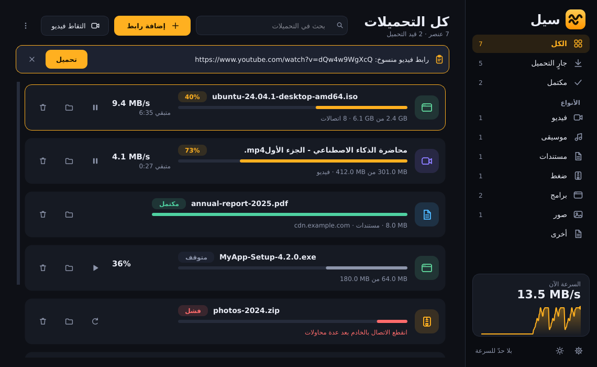

# سيل — مدير تحميل خاص بك

## للمستخدم العادي: ابدأ من هنا
1. حمّل **Sayl.exe** من صفحة الإصدارات: https://github.com/mohdgeek/sayl/releases/latest وشغّله بنقرتين (لا يحتاج تثبيتًا).
   - إذا ظهرت شاشة زرقاء من ويندوز (SmartScreen): اضغط «مزيد من المعلومات» ثم «تشغيل على أي حال». سببها أن الملف غير موقّع رقميًا.
2. ستظهر نافذة ترحيب. اضغط **تثبيت إضافة Chrome** واتبع الخطوات الثلاث المكتوبة (دقيقة واحدة). لا حاجة لنسخ أي رمز.
3. ألصق أي رابط في سيل، أو اضغط زر «تحميل» الذي يظهر فوق الفيديوهات في المتصفح.
4. التحديثات: تظهر تلقائيًا، أو من الإعدادات ← التحديث ← «تحقق الآن».

**مشاكل شائعة:** سجل الأخطاء في `C:\Users\اسمك\.sayl\sayl.log`. للفيديو بأعلى جودة وتحويل MP3 ثبّت ffmpeg بالأمر `winget install ffmpeg`.

## للمطوّر: نشر إصدار جديد
غيّر `__version__` في `sayl/__init__.py` ثم `git push` إلى `main`. يبني GitHub Actions الملف `Sayl.exe` وينشر الإصدار تلقائيًا، فيصل التحديث لكل المستخدمين.


مدير تحميل لسطح المكتب مكتوب من الصفر بـ Python وPySide6 (ويندوز ولينكس وماك)، مع إضافة Chrome تلتقط الروابط والفيديوهات.



## المميزات

**التحميل**
- تقسيم الملف إلى أجزاء متوازية (حتى 32 اتصالًا) مع تقسيم ديناميكي للأجزاء المتبقية.
- استئناف بعد الإيقاف أو إغلاق البرنامج أو انقطاع الاتصال.
- طابور بعدد تحميلات متزامنة وحدّ للسرعة وإعادة محاولة تلقائية.

**الفيديو والصوت** (عبر yt-dlp)
- يوتيوب وفيميو وتويتر/X وإنستغرام وتيك توك وغيرها من المواقع التي يدعمها yt-dlp، وروابط البث HLS (`.m3u8`) وDASH (`.mpd`).
- فحص الرابط لمعرفة العنوان والمدة والجودات المتاحة، واختيار الجودة أو «صوت فقط (MP3)».
- لا يدعم المحتوى المحمي بـ DRM (مثل نتفليكس) ولا يتجاوز أي حماية.

**الواجهة**
- سمة داكنة وفاتحة، وشريط جانبي بالتصنيفات (فيديو، موسيقى، مستندات، ضغط، برامج، صور) مع عدّاد لكل تصنيف.
- شريط سرعة حيّ بمنحنى لآخر دقيقة ونصف، وبحث فوري في القائمة.
- لافتة تظهر عند نسخ رابط ملف أو فيديو وتقترح تحميله، وسحب وإفلات الروابط على النافذة.
- قائمة نقر أيمن: فتح الملف أو المجلد، نسخ الرابط، نسخ SHA-256 للملف.
- أيقونة في شريط النظام وإشعار عند اكتمال التحميل.

**إضافة Chrome**
- ترصد الفيديوهات وقوائم البث في كل تبويب وتعرضها في النافذة المنبثقة مع شارة بالعدد على الأيقونة.
- زر «تحميل» عائم يظهر فوق أي فيديو عند تمرير الفأرة عليه.
- «تحميل فيديو هذه الصفحة»، وخيار في قائمة النقر الأيمن للروابط والصفحات.
- التقاط تحميلات Chrome تلقائيًا ونقل الكوكيز والـ Referer. إذا كان البرنامج مغلقًا يكمل Chrome التحميل بنفسه.

## الجدولة والتنظيم
- **الجدولة:** الطابور يعمل داخل فترة تحددها فقط (تدعم عبور منتصف الليل)، وخيار «ابدأ لاحقًا» عند الإضافة، وقائمة ⋮ ← «بعد انتهاء الطابور» (إغلاق سيل أو إطفاء الجهاز بمهلة 60 ثانية قابلة للإلغاء).
- **حدّ سرعة زمني:** حدّ مختلف في ساعات معيّنة (مثل ساعات الدوام).
- **قوائم التشغيل:** افحص رابط قائمة (يوتيوب وغيره) فتظهر عناصرها لتختار منها (حتى 300 عنصر).
- **الترجمة:** تحميل ملفات SRT بلغات تختارها (مثل `ar,en`) مع الفيديو.
- **تحديث yt-dlp** من الإعدادات ← الفيديو (من الشيفرة المصدرية فقط؛ في Sayl.exe أعد البناء بعد التحديث).
- **ترتيب تلقائي** في مجلدات (فيديو، مستندات، ضغط، …).
- **كشف التكرار:** تنبيه عند إضافة رابط أو ملف موجود سابقًا (يشمل التحميلات القادمة من الإضافة).
- **مجلد مراقَب:** أي ملف `.txt` أو `.url` تضعه فيه تُحمَّل روابطه، ثم يُعاد تسميته `.done`.
- **الألوان:** الإعدادات ← المظهر: أربع سمات (داكن، منتصف الليل، أسود OLED، فاتح)، و7 ألوان إبراز جاهزة، ولون مخصص للإبراز والنجاح والخطأ، مع معاينة فورية وزر استعادة.

## النشر على GitHub والتحديث من داخل البرنامج
1. أنشئ مستودعًا فارغًا على حسابك ثم ارفع المشروع (انظر الأوامر أدناه).
2. لإصدار نسخة جديدة: غيّر `__version__` في `sayl/__init__.py`، ثم `git tag v2.2.0 && git push --tags`. يبني GitHub Actions الملف `Sayl.exe` وينشره في Releases تلقائيًا.
3. في البرنامج: الإعدادات ← التحديث ← اكتب `username/repo` ← «تحقق الآن» ← «حدّث الآن». ينزّل الإصدار ويتحقق منه ثم يستبدل نفسه ويعيد التشغيل. ويُفحص تلقائيًا عند كل تشغيل.

```
git remote add origin https://github.com/USERNAME/sayl.git
git push -u origin main
```

## التشغيل
```bash
pip install -r requirements.txt
python -m sayl
```
لأعلى جودة فيديو (دمج الصوت والصورة) وللتحويل إلى MP3 ثبّت **ffmpeg**: على ويندوز `winget install ffmpeg`. بدونه تُحمَّل الصيغ الجاهزة فقط (غالبًا حتى 720p).

## ربط إضافة Chrome
1. شغّل البرنامج، وافتح **الإعدادات** وانسخ **رمز الإضافة**.
2. في Chrome افتح `chrome://extensions`، فعّل **وضع المطوّر**، ثم **تحميل إضافة غير مضغوطة** واختر مجلد `extension`.
3. افتح إعدادات الإضافة والصق الرمز، ثم **حفظ واختبار الاتصال**.

## بناء Sayl.exe (على ويندوز)
PyInstaller لا يبني لغير نظامه، لذا يُبنى الـ exe على ويندوز بإحدى طريقتين:
1. **على جهازك:** ثبّت Python 3.10+ (مع PATH) ثم انقر مرتين على `build_windows.bat`. يظهر الملف في `dist\Sayl.exe`.
2. **عبر GitHub Actions:** ارفع المشروع إلى مستودع، ثم من تبويب Actions شغّل **Build Windows exe** ونزّل الملف.

قد يحذّر SmartScreen أو مضاد الفيروسات لأن الملف غير موقَّع رقميًا، وهذا شائع مع ملفات PyInstaller.

## الأمان
- الخادم المحلي يستمع على `127.0.0.1` فقط ويشترط رمزًا سرّيًا، ويرفض أي `Host` أو `Origin` غير متوقع.
- يقبل روابط `http/https` فقط، ويمرّر ترويسات محدّدة فقط (Cookie وReferer وغيرها).
- ملفا `config.json` و`downloads.json` في `~/.sayl` بصلاحيات المالك فقط، لأنهما قد يحويان كوكيز.
- الإضافة تطلب صلاحية `<all_urls>` لأنها ترصد طلبات الوسائط وتضيف الزر العائم. لا ترسل شيئًا إلا إلى `127.0.0.1`.

## الاستخدام المسؤول
نزّل فقط ما تملك حق تنزيله، والتزم بشروط المواقع وحقوق النشر في بلدك.

## الاختبارات
```bash
pip install pytest playwright
python -m pytest tests -q                                   # المحرّك والفيديو (HLS محلي) والخادم
QT_QPA_PLATFORM=offscreen python tests/gui_smoke.py         # الواجهة
python tests/e2e_extension.py out                           # الإضافة في Chromium حقيقي
QT_QPA_PLATFORM=offscreen python tests/shots.py out         # لقطات الواجهة
node tests/lib.test.js                                      # منطق رصد الوسائط
```

## هيكل المشروع
| الملف | الدور |
|---|---|
| `sayl/engine.py` | محرّك التحميل المقسّم والاستئناف وتحديد السرعة |
| `sayl/media.py` | تحميل الفيديو والصوت (yt-dlp) وفحص الروابط |
| `sayl/manager.py` | الطابور والمجدول وحفظ القائمة وسجل السرعة |
| `sayl/server.py` | الخادم المحلي لإضافة المتصفح |
| `sayl/gui.py`، `widgets.py`، `dialogs.py` | النافذة والمكوّنات والحوارات |
| `sayl/theme.py`، `icons.py` | السمات والأيقونات المرسومة بالكود |
| `sayl/categories.py` | تصنيف الملفات |
| `extension/` | إضافة Chrome (MV3): الرصد، النافذة، الزر العائم |

## أفكار للتوسّع
جدولة بالوقت، وتحميل قوائم التشغيل، وتحميل المواقع كاملة، ودعم FTP، وتوقيع الـ exe رقميًا.
